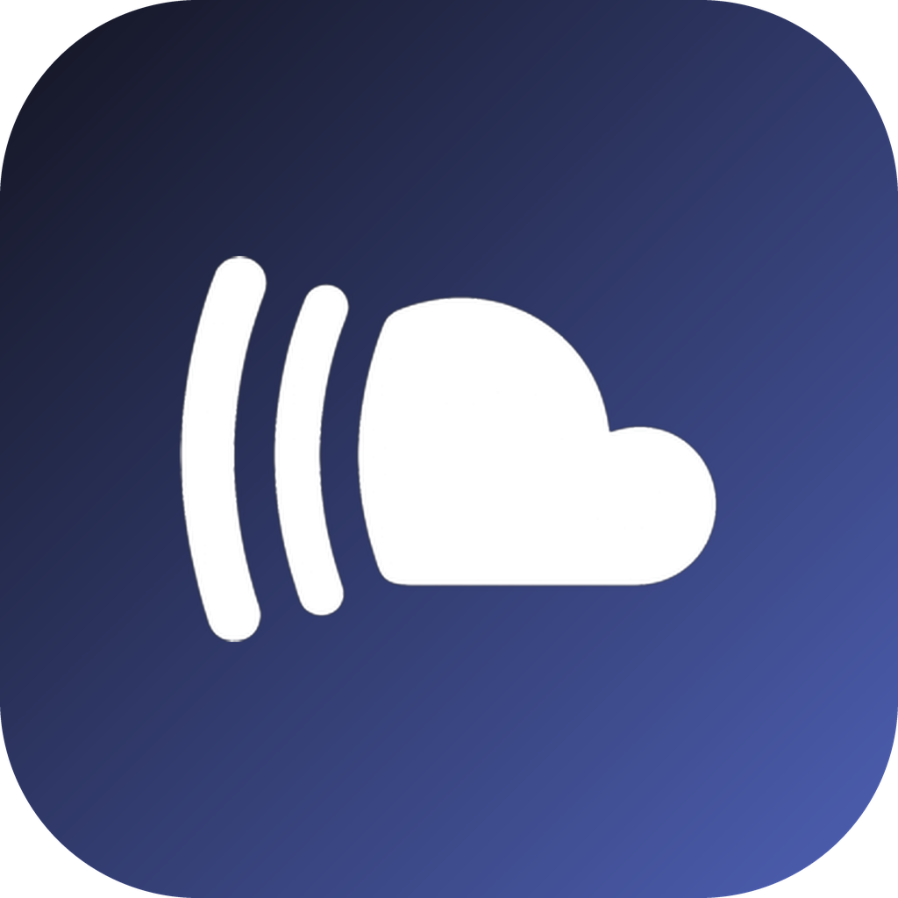

<p align="center">
  
</p>

<h1 align="center">Unison</h1>

<p align="center">
  <strong>Spotify, SoundCloud, Discography and your own music files in one window.</strong><br>
  One queue that mixes all three, one Liked Songs list, one search, wrapped in frosted glass that takes its colour from whatever is playing.
</p>

<p align="center">Windows desktop app · Electron + React</p>

<p align="center"><a href="https://github.com/hangoverhangoverhangover/Unison/releases/latest"><strong>Download the latest installer</strong></a></p>

---

## Features

### Play everything together

- **Spotify** (Premium), **SoundCloud**, **Discography** ([discography.stream](https://discography.stream)) and **local files** (MP3, FLAC, M4A and more) in one queue. Skip from a Spotify song to a SoundCloud track to a file on your disk without thinking about it.
- **Gapless Spotify playback**, and SoundCloud's protected (DRM) tracks play too.
- **Media keys**, a **mini player** that stays on top, and **close to tray** so the music keeps going.
- **Picks up where you left off:** your queue, track and position come back when you reopen the app.

### Your library

- **One Liked Songs list** kept in sync with Spotify and SoundCloud, with filters for each.
- **Mixed playlists** that hold songs from all three sources, with your own cover. Edit your Spotify and SoundCloud playlists too.
- **Copy a playlist** to the other service, with a review step before anything is added.
- **Local files:** watched folders (new files show up by themselves), sort by artist or album, and a **tag editor** for one file, a folder, or tags guessed from "Artist - Title" file names.
- **Duplicate finder** across your likes and local files. Nothing is removed without your OK.
- **History playlists:** Recently played, On repeat and Forgotten favourites.
- **Stats:** your top artists and tracks for the week, month or year.

### Search

- **One search for everything:** Spotify, SoundCloud and your files, mixed together, with a top result, songs, artists, and albums & playlists.
- **Quick search from anywhere** (`Ctrl+K`): results drop over whatever you're looking at. Enter opens all results.
- **Find on the other service:** match a song between Spotify and SoundCloud (by ISRC, then title and artist).

### SoundCloud, properly

- **Waveform with timed comments.** Each comment sits on the waveform as the commenter's picture; hover to read it, click to jump there. Post comments too.
- **Track, artist, album and playlist pages,** with threaded comments, reposts and Download all.
- **Feed** of uploads and reposts from people you follow; follow and unfollow artists.
- **Downloader:** saves the official file when there is one, otherwise the stream, with tags and artwork. Downloads land in your local library, linked to the SoundCloud track. Optionally download new likes automatically.

### Player page

- **A full-window view of what's playing:** the artist's bio from Last.fm, the cover, the whole lyrics with the current line lit, and what's up next (point at it to see titles). Full screen hides everything but the play bar.
- **Your own backgrounds:** pictures, GIFs or videos for a song, an artist, an album or every song (right-click the page). When more than one fits, they can **swap** after a set time or a set number of plays.
- **Visualizer:** bars, mirrored bars, wave, a ring around the cover, a circular waveform, particles, a spectrogram, or a **shader** that bends the cover (liquid, kaleidoscope, warp). Put it at the bottom, around the cover, behind the whole page or behind the lyrics, and stack up to three styles.
  - Peak caps, gradients from the cover's colours, trails, glow, smoothing and a musical frequency scale.
  - **Beat detection:** the cover bumps, the background flashes and the bars kick on each beat; the background can also breathe with the bass.
  - **Presets** (Chill, Club, Retro, Minimal, Dreamy, Dreamy + bars, Galaxy) and your own saved looks.
  - **Edit it live:** right-click the Player page → Edit visualizer… opens the settings in a panel over the page.
  - **Spotify songs:** Spotify's audio can't be read, so an opt-in setting lets the visualizer listen to your PC's sound instead.

### Listen together

- **Jam:** start a session, share the code, and everyone adds to one queue. Each person plays on their own accounts, and playback stays in sync across Spotify and SoundCloud.

### Lyrics and scrobbling

- **Synced lyrics** from LRCLIB, with Genius as a backup (add a Genius token): a full lyrics page that follows the song (click a line to jump there), the current line above the play bar and in the mini player.
- **Your own lyrics:** paste them and tap along as the song plays to time each line, and each word if you like. They stay on your computer.
- **Last.fm scrobbling** with your own Last.fm API account (Settings → Accounts → Last.fm). Works offline: scrobbles wait and send later.

### Look and feel

- **Frosted glass** over a colour wash taken from the playing song's artwork, fixed **Dark** and **Light** themes, or a **Custom** theme: your own colours, gradient or picture background, glass blur and corners, and font. Themes save to a file you can share.
- A floating play bar the page scrolls under, a resizable sidebar that folds into an icon strip, and a tabbed side panel (Details, Queue, Jam), also resizable.
- **Whole-app zoom** (`Ctrl +` / `Ctrl −` / `Ctrl 0`, or Ctrl + mouse wheel).
- **Sound:** volume levelling, crossfade and an equalizer for SoundCloud and local files.
- **Discord status:** shows what you're playing, with artwork and a progress bar.
- **Automatic updates** from GitHub Releases, installed when you restart.

---

## Install

1. Download `Unison-Setup-<version>.exe` from the [latest release](https://github.com/hangoverhangoverhangover/Unison/releases/latest).
2. Run it. The installer isn't code-signed, so Windows may show **"Windows protected your PC"**: click **More info → Run anyway**.
3. Pick where to install it, then open Unison from the Start menu or the desktop shortcut.

Then connect your accounts:

- **Spotify** needs a free Client ID of your own (5 minutes, see [Setting up Spotify](#setting-up-spotify)) and **Spotify Premium**.
- **SoundCloud** works with your normal login (see [Setting up SoundCloud](#setting-up-soundcloud)).
- **Local files:** **Settings → Music folders → Add folder**.
- **Discord status:** turn on **Settings → General → Show on Discord**.

The SoundCloud downloader and the tag editor are included; nothing else to install. Needs **Windows 10 or 11**.

---

## Run from source

Only needed if you want to change the code. The installer needs none of this.

### Requirements

- **Windows 10 or 11.**
- **Node.js 22** and **Python 3.7+** (Python is only for the one-time Widevine signing step below).
- A free **castLabs EVS account** (also for that signing step).
- For Spotify: **Spotify Premium**, on every account that plays music.
- Optional: `yt-dlp.exe` and `ffmpeg.exe` for the SoundCloud downloader and the tag editor.

### 1. Install

```bash
git clone <this repository's URL>
cd <the repository folder>
npm install
```

`npm install` brings in castLabs' build of Electron, which includes Widevine (the DRM that Spotify and some SoundCloud tracks need).

### 2. Sign Electron for Widevine (one time)

Spotify only plays in a Widevine build that has been signed for production. castLabs signs it for free:

```bash
python -m pip install --upgrade castlabs-evs
```

```bash
python -m castlabs_evs.account signup
```

```bash
npm run vmp:sign
```

Run these in a normal PowerShell or Command Prompt window: the last one asks for your castLabs login.

> [!IMPORTANT]
> Run `npm run vmp:sign` again **after anything that reinstalls Electron** (a fresh `npm install`, an Electron upgrade). Without it, Spotify songs play for a few seconds and then stop with a playback error.

To check the signature at any time:

```bash
python -m castlabs_evs.vmp verify-pkg node_modules/electron/dist
```

### 3. Add your keys

Copy `.env.example` to `.env` in the project folder and fill in what you have:

```ini
SPOTIFY_CLIENT_ID=        # see "Setting up Spotify" below
SOUNDCLOUD_CLIENT_ID=     # optional, leave blank (SoundCloud works through your normal login)
SOUNDCLOUD_CLIENT_SECRET= # optional, leave blank
DISCORD_APP_ID=           # optional, for the Discord status
```

Everything is optional: the app starts without any keys, and local files always work. You can also enter the Spotify Client ID later in **Settings → Accounts**. `.env` is in `.gitignore`; never commit it.

### 4. Optional: downloader and tag editor tools

Put `yt-dlp.exe` and `ffmpeg.exe` in a `bin` folder in the project root (`bin/yt-dlp.exe`, `bin/ffmpeg.exe`). The downloader uses both; the tag editor uses ffmpeg.

### 5. Run it

```bash
npm run dev
```

The first launch downloads the Widevine module, so it needs an internet connection.

---

## Setting up Spotify

Spotify only lets an app play music for accounts its owner has allowed, so you register your own (free) Spotify app:

1. Go to the [Spotify Developer Dashboard](https://developer.spotify.com/dashboard) and log in with your Spotify account.
2. **Create app.** Give it any name and description.
3. Under **Redirect URIs**, add a loopback address with a port, for example:

   ```
   http://127.0.0.1:8888/callback
   ```

   Any free port works (`:8888` and `:3000` are common). The app uses `http://127.0.0.1:8888/callback` unless you change it: if yours is different, type it in **Settings → Accounts → Spotify → Use your own Client ID → Redirect URI**. It has to match the one on your Spotify app exactly, port included.

4. Under **Which API/SDKs are you planning to use?**, tick **Web API** and **Web Playback SDK**. Save.
5. Open the app's **Settings → User Management** and add every Spotify account that will use it (name and the account's email). The app is in Development Mode, which allows **up to 5 people**.
6. Copy the **Client ID** and paste it in the app under **Settings → Accounts → Spotify → Use your own Client ID**, then restart when it asks. (Running from source, you can put it in `SPOTIFY_CLIENT_ID` in `.env` instead.) There's no client secret to copy: the login uses PKCE.
7. Start the app, open **Settings → Accounts** and press **Connect** next to Spotify. Your browser opens Spotify's consent page; approve it and the app shows your account.

Good to know:

- **Every listener needs Premium**, including the app's owner. A free account sees an "account error" when playing.
- Each person in a Jam who plays Spotify needs to be on your app's user list, or use their own Client ID in Settings.
- The login lasts six months; after that the app asks you to connect again.
- Development Mode limits what Spotify shares: playlists you follow but don't own can't be opened, and search returns 10 songs per page.

---

## Setting up SoundCloud

No API key needed: the app uses your normal SoundCloud login.

1. **Settings → Accounts → SoundCloud → Connect.**
2. A SoundCloud sign-in window opens. Log in however you normally do (email, Google, Apple or Facebook). The window closes by itself once you're in.

**Sign-in window blocked?** SoundCloud's bot protection sometimes blocks it. Use the token instead:

1. Log in at [soundcloud.com](https://soundcloud.com) in your own browser and press `F12`.
2. Chrome or Edge: **Application → Storage → Cookies → https://soundcloud.com**. Firefox: **Storage → Cookies**.
3. Copy the **value** of the cookie named `oauth_token`.
4. In the app: **Settings → Accounts → "Login window blocked? Connect with a token instead"**, paste it and press **Connect**.

> [!CAUTION]
> The `oauth_token` gives full access to your SoundCloud account. Treat it like a password: never share it or paste it anywhere except that Settings field.

SoundCloud search and playback also work without logging in; likes, playlists, the feed, comments and downloads of Go+ tracks need the login.

---

## Setting up Discography

Settings → Accounts → Discography → **Connect** opens discography.stream's own login (Discord or Google). Once you're in, Discography songs show up in Search next to the others. Liking, its playlists and downloads aren't supported.

## Optional extras

### Discord status

With the installer, turn on **Settings → General → Show on Discord** and keep the Discord desktop app running. That's all.

Running from source, register your own Discord application:

1. Create an application in the [Discord Developer Portal](https://discord.com/developers/applications).
2. Under **Rich Presence → Art Assets**, upload the images from `design/discord-assets/` with the same names (`app_icon`, `spotify`, `soundcloud`, `local`).
3. Copy the **Application ID** into `DISCORD_APP_ID` in `.env`.
4. Name the Discord application **Unison**: Discord shows that name as "Listening to Unison".
5. Turn on **Settings → General → Show on Discord**. The Discord desktop app must be running.

If your Discord account is linked to Spotify, Discord shows two statuses while Spotify plays. Unlink Spotify under Discord's **Connections** to avoid that.

### Jam

Jam works out of the box with the built-in relay. Set your display name in **Settings → Jam**, then open the **Jam** tab in the side panel to start or join a session. To run your own relay, see `relay/README.md` and put its address in **Settings → Jam → Relay URL** (everyone in a session must use the same relay).

### Keys without rebuilding

Instead of `.env`, you can put the same keys in `%APPDATA%\Unison\config.json`:

```json
{ "SPOTIFY_CLIENT_ID": "…", "DISCORD_APP_ID": "…" }
```

Values there override `.env`.

---

## Keyboard shortcuts

| Keys                                 | Action                           |
| ------------------------------------ | -------------------------------- |
| `Space`                              | Play or pause                    |
| `Ctrl` `→` / `Ctrl` `←`              | Next / previous track            |
| `→` / `←`                            | Forward / back 5 seconds         |
| `↑` / `↓`                            | Volume up / down                 |
| `M`                                  | Mute or unmute                   |
| `Ctrl` `L`                           | Like or unlike the playing track |
| `Ctrl` `K`                           | Quick search                     |
| `Ctrl` `F`                           | Search in the current list       |
| `Alt` `←` / `Alt` `→`                | Back / forward                   |
| `Ctrl` `+` / `Ctrl` `−` / `Ctrl` `0` | Zoom in / out / reset            |

The full list is also in **Settings → Shortcuts**.

---

## Troubleshooting

| Problem                                             | Fix                                                                                          |
| --------------------------------------------------- | -------------------------------------------------------------------------------------------- |
| Spotify plays a few seconds, then stops             | Run `npm run vmp:sign` again (Electron was reinstalled).                                     |
| Spotify: "account error"                            | That account needs Premium.                                                                  |
| Spotify: errors or empty lists after login          | Add the account under **User Management** in your Spotify app (max 5).                       |
| Spotify login page says the redirect URI is invalid | The Redirect URI in the app's Settings must match your Spotify app's exactly, port included. |
| SoundCloud sign-in says "You have been blocked"     | Wait a few minutes, or connect with the `oauth_token` (above).                               |
| Protected tracks don't play on first launch         | The first launch downloads Widevine; make sure you're online and restart.                    |
| Widevine fails when started from another app        | Start the app from a normal PowerShell or Command Prompt window.                             |
| Downloads or the tag editor don't work              | Put `yt-dlp.exe` and `ffmpeg.exe` in `bin/`.                                                 |

---

## Development

| Command                        | What it does                                                    |
| ------------------------------ | --------------------------------------------------------------- |
| `npm run dev`                  | Run with hot reload                                             |
| `npm test`                     | Unit tests (Vitest, run inside Electron's Node)                 |
| `npm run typecheck`            | TypeScript checks for main and renderer                         |
| `npm run lint`                 | ESLint                                                          |
| `npm run build`                | Typecheck and build to `out/`                                   |
| `node scripts/smoke-glass.mjs` | Screenshots of every page in each theme (after `npm run build`) |
| `npm run dist`                 | Build the Windows installer into `dist/` (see below)            |
| `npm run release`              | Build the installer and upload it to a GitHub release (below)   |

### Building the installer

1. Put `yt-dlp.exe` and `ffmpeg.exe` in `bin/` (they are bundled next to the app).
2. Log in to castLabs EVS once if your login has expired: `python -m castlabs_evs.account reauth`.
3. Run `npm run dist`. The installer is `dist/Unison-Setup-<version>.exe`; `dist/win-unpacked/` is the same app without an installer.

The build VMP-signs `Unison.exe` after packaging, which Spotify playback needs. `SKIP_VMP=1 npm run dist` builds without signing (Spotify won't play in that build).

### Publishing a release (auto updates)

The installed app checks GitHub Releases for new versions, downloads them in the background and installs them on restart (Settings → General → Updates).

1. Raise `version` in `package.json` (updates only go to a higher version).
2. Set `GH_TOKEN` to a GitHub token that can create releases on this repository, for this terminal only.
3. Run `npm run release`. It builds and VMP-signs like `npm run dist`, then uploads `Unison-Setup-<version>.exe`, its `.blockmap` and `latest.yml` to a draft release.
4. Publish the draft on GitHub. Installed apps only see published releases.

Release builds include only public identifiers from `.env`: the Discord application ID and the Jam relay URL. Spotify and SoundCloud keys are left out, so everyone who installs the app adds their own Spotify Client ID in Settings → Spotify.

Project layout: `src/main` (Electron main process: services, library, database, IPC), `src/preload` (typed IPC bridge), `src/renderer` (React UI), `src/shared` (types shared by both), `relay/` (Jam relay, Cloudflare Worker).

### Built with

castLabs Electron (Widevine) · React 19 · TypeScript · Tailwind CSS 4 · Zustand · Motion · hls.js · better-sqlite3 · electron-vite · Vitest · Playwright

---

## Disclaimer

A personal project, not affiliated with or endorsed by Spotify, SoundCloud or Discord. The SoundCloud features use the same web endpoints as soundcloud.com, which can change without notice. Use the downloader only for tracks you have the right to keep.
